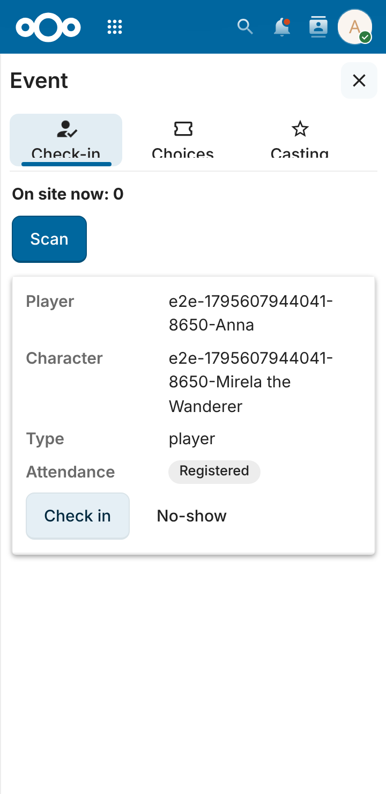
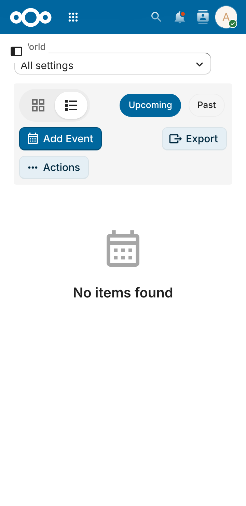
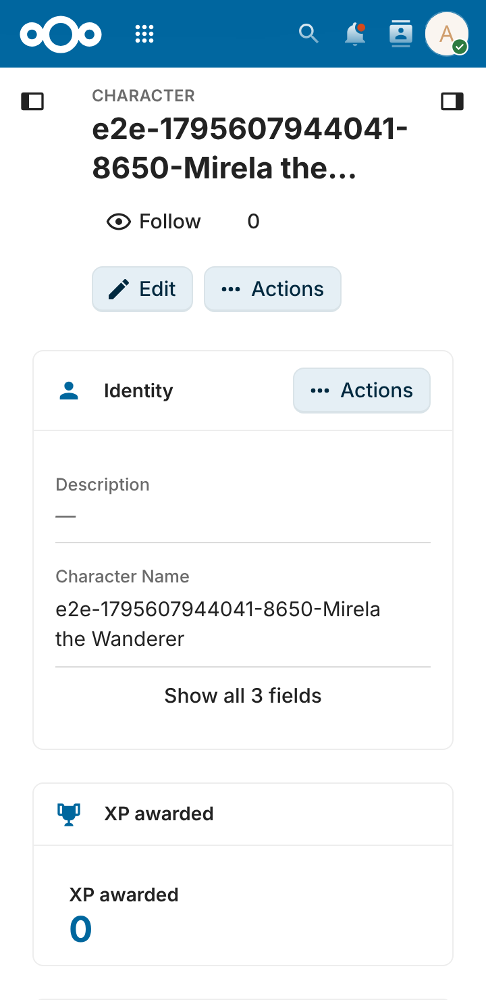
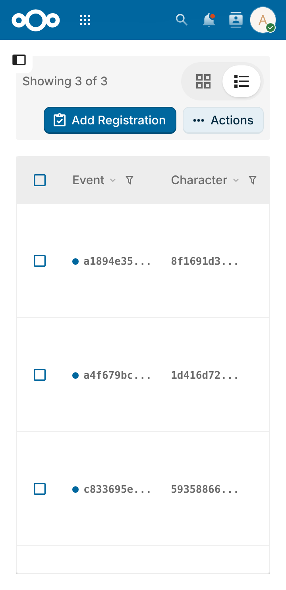
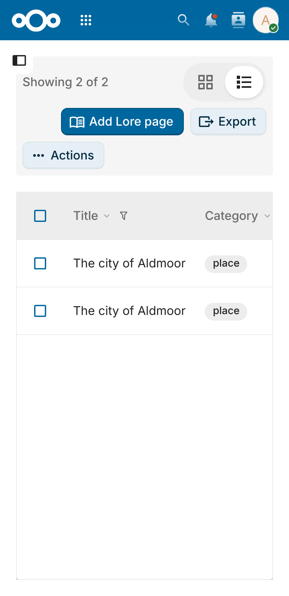

# Using larpinq on a phone

The pages people use at an event work on a phone 360 pixels wide, without scrolling sideways. Tables become stacked rows.

## Pages that fit a phone

- The **Check-in** tab of an event
- A character with its **Stats** tab, and the **Casting** and **Award XP** tabs
- **My registrations**
- The **Cast** page
- Lore pages
- The **Dashboard**
- The **Events** list

Players can read their character sheet between scenes: the abilities on the Stats tab read as stacked rows.

## Check-in with one hand

On a phone the Check-in tab is built for a steward standing at the gate:

- The scan panel and its **Check-in code** field span the width of the screen.
- The code field uses text large enough that the phone does not zoom in while you type.
- Each participant is a stacked row, with the **Check in** and **No-show** buttons on screen.
- The **Scan**, **Check in**, **No-show** and **Check out** buttons are at least 44 by 44 pixels.

How the codes themselves work is described in [Check in with a QR code](./qr-checkin.md).

## Screenshots

Taken at 360 pixels wide.

| Check-in tab | Events | Character |
|---|---|---|
|  |  |  |

| My registrations | Cast | Lore |
|---|---|---|
|  |  |  |
