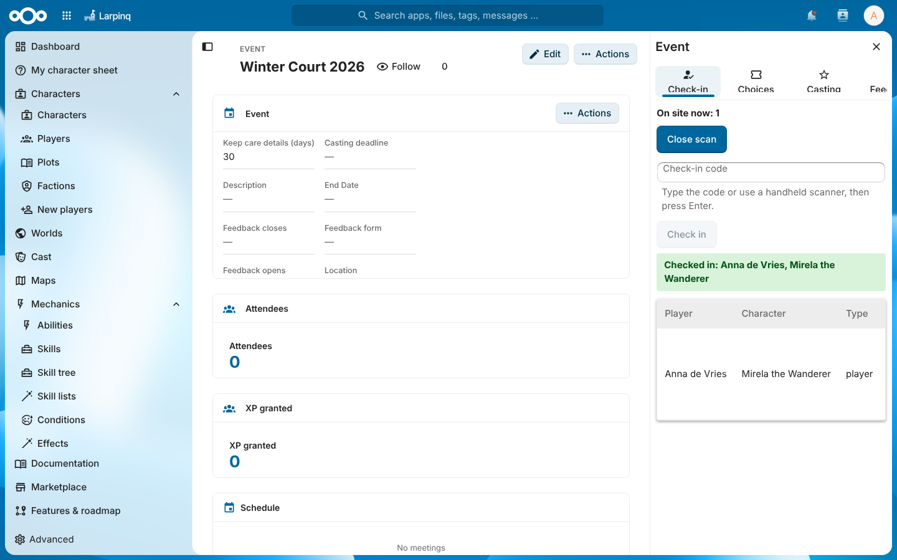

# Check in with a QR code

Every accepted registration gets a check-in code. The player shows it as a QR code at the gate, and a steward scans or types it on the event's **Check-in** tab.

## The player's code

When a game master accepts a registration, larpinq gives it a random code that cannot be guessed. Only the registration's player and game masters can read it.

On **My registrations** each accepted registration shows its QR code with the code as text beneath it. Print the page to bring it on paper: the print shows the QR code, the code, the player's name, the character and the event.

## Check in at the gate

Open the event, go to the **Check-in** tab and choose **Scan**.

- Where the browser supports it, the camera reads the QR code.
- The **Check-in code** field always works: type the code, or use a handheld scanner, then press Enter or **Check in**.

The panel answers with one line:

| Answer | What happened |
|---|---|
| Checked in: Anna de Vries, Mirela the Wanderer | The character is checked in on the roster |
| Already checked in at 18:02 by Joris | The code was used before; nothing changes |
| This registration is not accepted. Nobody was checked in. | The registration is pending, waitlisted or cancelled |
| Unknown code, or a code for another event. Nobody was checked in. | The code does not belong to this event |
| Only game masters can check participants in. | The account may not check participants in |
| Too many attempts. Wait a moment and try again. | Too many codes were tried in a short time |

**Close scan** hides the panel again. The roster keeps its **Check in**, **No-show** and **Check out** buttons for checking in by hand.

On a phone the scan panel spans the width and its buttons are large enough to press with a thumb. See [Using larpinq on a phone](./phone-use.md).

## Screenshot

The scan panel on the event's **Check-in** tab, after a steward checked Anna in with her code:

