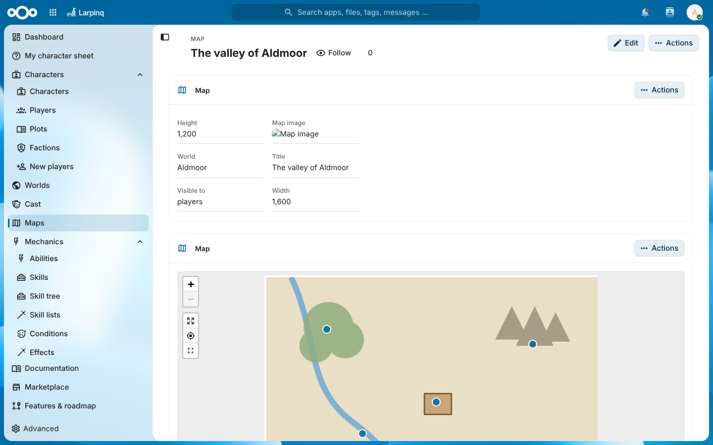

# World maps

Game masters upload the maps of a world and place pins on them: towns, camps, ruins, dangers. A pin can link to the lore page about the place. Players see the maps and pins meant for them.

## Upload a map

Open **Maps** and choose **Add**. Give the map a title, the world it belongs to, the map image, and its width and height in pixels. **Visible to** decides who sees it: game masters only, or players too.

The maps of a world are also listed on the world itself, under **Maps of this world**.

## Place pins

Open a map. The **Pins** list shows every pin on it. Add a pin with:

- **Label**: the name shown beside the pin, such as "Aldmoor city".
- **X** and **Y**: the position on the image, in pixels from the left and top edge.
- **Kind**: town, camp, ruin, danger or other.
- **Lore page**: the page about this place, optional.
- **Visible to**: game masters only, or players too.

## Who sees what

| | Game master | Player |
|---|---|---|
| A map for game masters | Sees it | Never gets it |
| A map for players | Sees it | Sees it |
| A pin for game masters | Sees it | Never gets it |
| A pin for players | Sees it | Sees it |

OpenRegister applies these rules to every way of reading: the lists, the map page, search and exports. A player who opens the valley map does not get a pin such as "Ash grove" when it is for game masters only.

Only game masters upload, change and delete maps and pins.

## The map page

Open a map to see it as a picture with its pins on it. Zoom in and out, and click a pin to see its label and open the lore page it links to. Below the picture the **Pins** list shows the same pins as a table.

